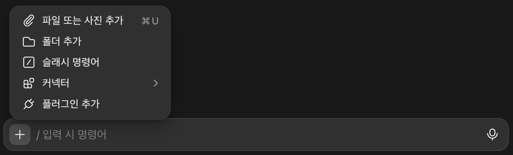
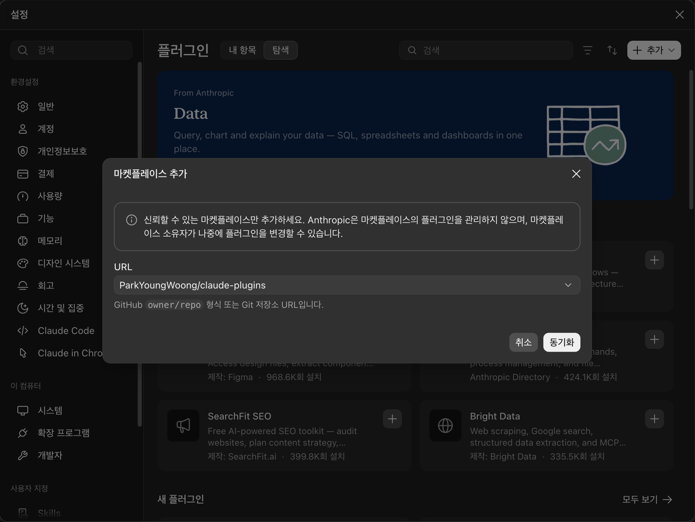
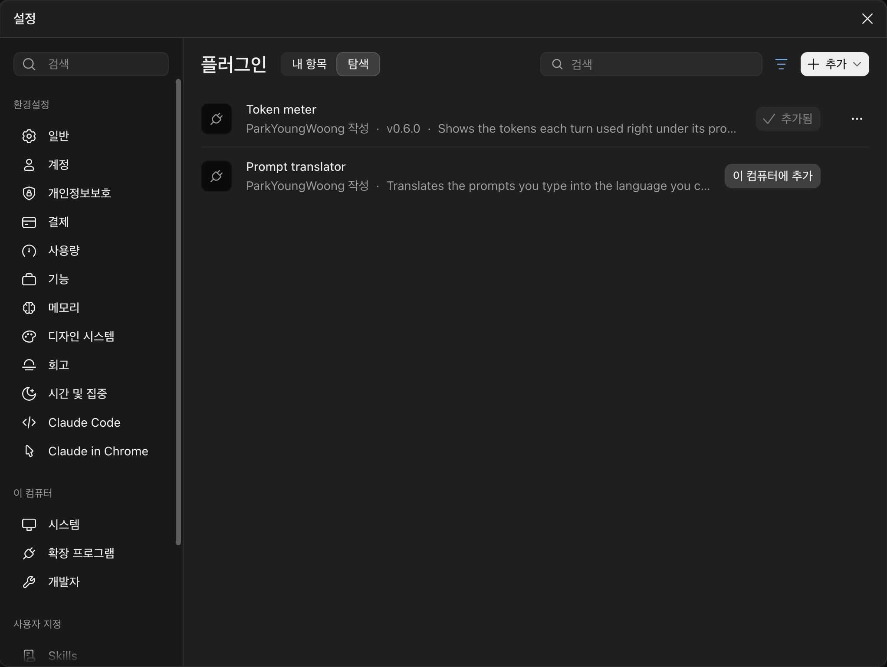
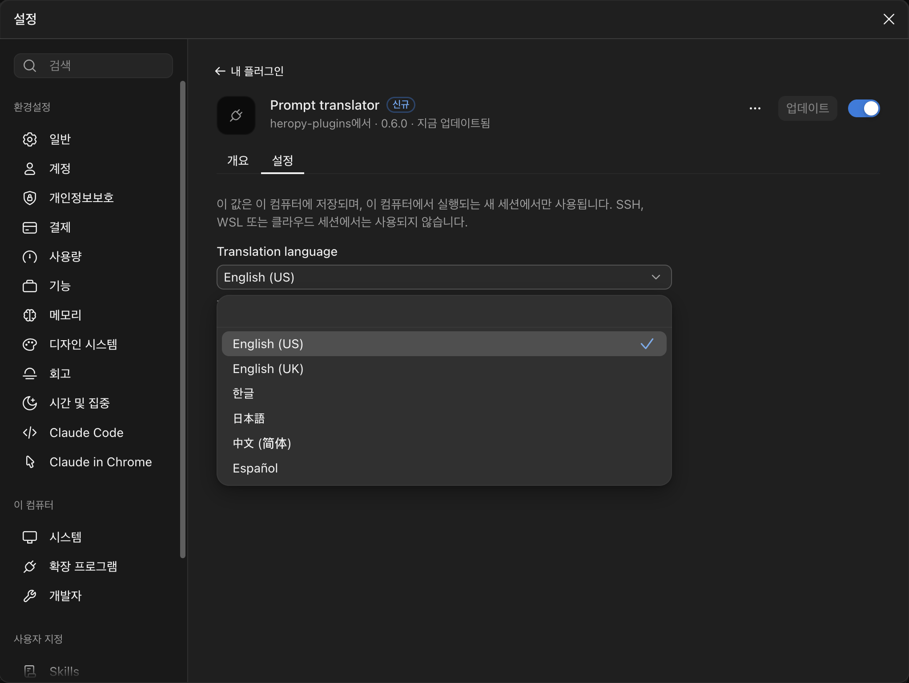
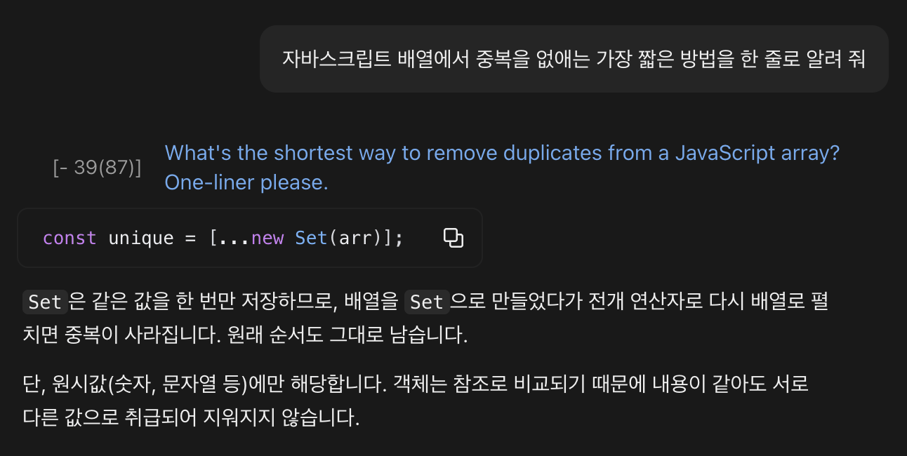

# prompt-translator

입력한 프롬프트를 고른 언어로, 그 언어를 쓰는 개발자가 실제로 쓰는 자연스러운 문장으로 번역하는 Claude Code Mod입니다.  
번역은 대화 기록의 프롬프트 줄 바로 밑에 보입니다.  
번역할 언어는 설치할 때 고르고, 기본값은 미국 영어입니다.

[English](./README.md)

```plaintext
> 이 함수에 에러 처리 좀 추가해 줘
  [- 19(44)] Can you add error handling to this function?
```

## 설치

### Claude Code CLI

Claude Code 터미널 세션의 프롬프트에서 실행합니다.

```plaintext
/plugin install prompt-translator --marketplace ParkYoungWoong/claude-plugins
```

1. 처음 설치할 때 `Add marketplace?`를 묻습니다.  
   `y`를 누릅니다.

   

2. 설치 범위를 고릅니다.  
   맨 위의 `Install for you (user scope)`로 설치하면 이후에 여는 모든 세션에서 동작합니다.

   

3. ←/→로 번역할 언어를 고르고 Enter를 누른 뒤, `Save configuration`에서 Enter를 한 번 더 누릅니다.

   

4. `Installed and configured prompt-translator. Plugin is now active.`가 보이면 지금 세션에서 바로 동작합니다.  
   프롬프트를 입력하면 바로 밑에 번역이 보입니다.

   

셸에서 설치할 때는 `--config`로 언어를 지정합니다.

```bash
claude plugin install prompt-translator --marketplace ParkYoungWoong/claude-plugins --config language=日本語
```

### 클로드 데스크톱 앱

데스크톱 앱에서는 `/plugin`을 쓸 수 없어서 플러그인 설정 화면에서 설치합니다.

1. 입력창 옆의 + 단추를 누르고 `플러그인 추가`를 고릅니다.

   

2. 오른쪽 위의 `추가`에서 `마켓플레이스 추가`를 고르고, `ParkYoungWoong/claude-plugins`를 입력한 뒤 `동기화`를 누릅니다.

   

3. `탐색` 탭에서 Prompt translator를 찾아 `이 컴퓨터에 추가`를 누릅니다.  
   필터의 `소스 > heropy-plugins`를 고르면 이 마켓플레이스의 플러그인만 보입니다.

   

4. 데스크톱 앱은 설치할 때 언어를 묻지 않아서 English (US)로 시작합니다.  
   바꾸려면 `내 항목` 탭에서 Prompt translator를 열고, `설정` 탭의 Translation language에서 고른 뒤 `저장`을 누릅니다.  
   바꾼 언어는 그 뒤에 새로 시작하는 세션부터 적용됩니다.

   

5. 새 세션에서 프롬프트를 보내면 터미널과 똑같이 프롬프트 바로 밑에 번역이 보입니다.

   

## 번역 언어

| 옵션 | 번역하는 언어 |
| --- | --- |
| `English (US)` (기본값) | 미국 영어 |
| `English (UK)` | 영국 영어(colour, organise 같은 영국식 철자) |
| `한글` | 한글 |
| `日本語` | 일본어 |
| `中文 (简体)` | 중국어 간체 |
| `Español` | 스페인어 |

고른 언어가 아닌 프롬프트만 번역합니다.  
예를 들어 `한글`을 고르면 영어 프롬프트는 한글로 번역하고, 한글 프롬프트는 그대로 둡니다.

터미널에서 언어를 바꾸려면 `/config`를 실행하고 `translation`을 입력해 `Translation language`를 찾은 뒤 새 언어를 고릅니다.  
Mod가 바로 새 언어로 다시 로드됩니다.


`日本語`로 바꾼 뒤에는 같은 한글 프롬프트가 일본어로 번역됩니다.


## 동작

- 번역은 보기 전용입니다.  
  Claude에게는 입력한 원문이 그대로 전달됩니다.
- 번역과 Claude의 작업은 동시에 시작합니다.  
  번역이 끝날 때까지 프롬프트 밑에 `Translating...`이 보이고, 끝나면 같은 자리가 번역문으로 바뀝니다.
- 번역은 프롬프트 줄에 붙어 있어서, 대화 기록을 스크롤하면 함께 움직입니다.
- 앞의 `[- 19(44)]`는 원문의 글자 수(공백 포함)와 괄호 안의 번역문 글자 수입니다.  
  누르면 그 번역만 숨겨지고 `[+ 19(44)]`로 바뀝니다.  
  다시 누르면 번역이 보입니다.
- 코드, 파일 경로, 명령어, 식별자, URL, @멘션, 백틱 안의 글은 그대로 둡니다.  
  그대로 써야 하는 인용문(정확한 답장, UI 문구, 커밋 메시지)도 원문을 유지합니다.
- 번역에 실패하면 `Could not translate (이유)`만 표시합니다.  
  Claude의 작업은 그대로 진행됩니다.
- `/goal`이나 스킬처럼 Claude에게 일을 시키는 슬래시 명령은 명령 뒤에 쓴 글(인자)을 번역합니다.  
  명령 줄에는 Mod가 그릴 자리가 없어서, 번역은 그 명령으로 시작한 Claude의 첫 답변 바로 위에 보입니다.
- 클로드 데스크톱 앱의 Claude Code에서도 동작합니다.  
  앱이 세션 화면을 붙이기 전에 보낸 첫 프롬프트는 화면이 붙는 대로 번역합니다.

## 번역하지 않는 경우

- 이미 고른 언어로 쓴 프롬프트
- `ok`, `continue`처럼 너무 짧아서 언어를 가릴 수 없는 프롬프트.  
  한글, 일본어, 중국어는 글자 모양으로, 영어와 스페인어는 흔히 쓰는 낱말로 가립니다.
- `/rename`처럼 Claude의 작업 없이 끝나는 슬래시 명령
- 작업 알림처럼 사람이 직접 입력하지 않은 메시지
- 화면이 없는 실행(`claude -p`)
- 공백과 붙여넣은 글을 포함해 300자가 넘는 프롬프트.  
  이때는 아무것도 표시하지 않습니다.

## 긴 프롬프트 번역: `ultratranslate`

프롬프트 아무 곳에나 `ultratranslate`를 넣으면(대소문자 구분 없음) 300자가 넘어도 번역합니다.  
키워드는 Claude에게 넘기기 전에 빠지므로 작업 내용에는 영향을 주지 않습니다.  
슬래시 명령의 인자에 넣어도 됩니다(`/goal ... ultratranslate`).

## 비용

번역은 Claude Sonnet 5.5(`claude-sonnet-5-5`, effort low)로 요청합니다.  
지금 세션에 로그인한 계정의 사용량에 포함됩니다.

## 끄기

`/plugin`에서 prompt-translator를 끄거나, 셸에서 다음 명령을 실행합니다.

```bash
claude plugin disable prompt-translator@heropy-plugins
```

## 개발

```bash
claude plugin validate plugins/prompt-translator
claude plugin test plugins/prompt-translator
```
