# prompt-translator

A Claude Code mod that translates the prompts you type into the language you choose, the way a native-speaking developer would actually write them.  
The translation shows right under the prompt in the transcript.  
You pick the language when you install it, and the default is American English.

Read this in [한글](./README.ko.md).

```plaintext
> 이 함수에 에러 처리 좀 추가해 줘
  [Hide] Can you add error handling to this function?
```

## Install

### Claude Code CLI

Run this from the prompt of a Claude Code terminal session.

```plaintext
/plugin install prompt-translator --marketplace ParkYoungWoong/claude-plugins
```

1. The first install asks `Add marketplace?`.  
   Press `y`.

   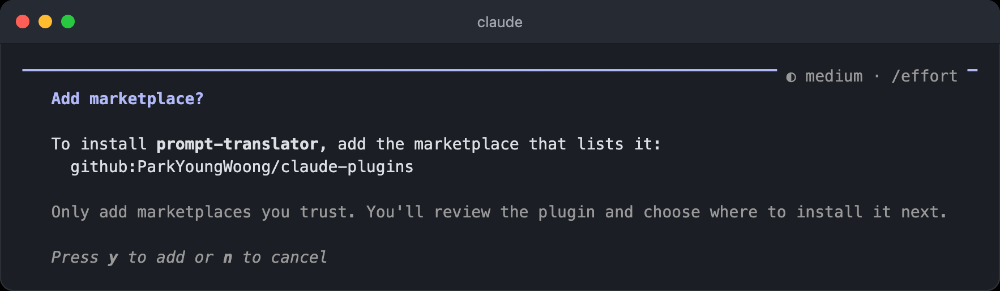

2. Pick where to install it.  
   With `Install for you (user scope)` at the top, it works in every session you open.

   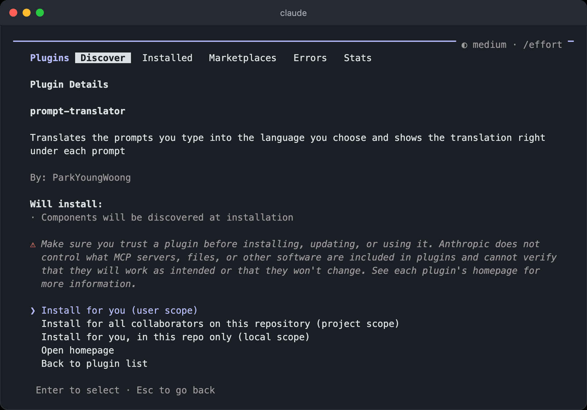

3. Pick the translation language with ←/→ and press Enter.  
   Type a number for `Auto-translate limit` and press Enter, or just press Enter to keep the default of 300.  
   Then press Enter on `Save configuration`.

   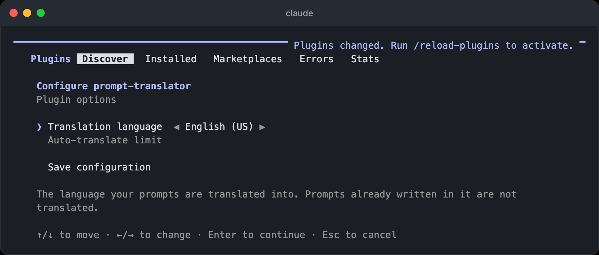

4. When you see `Installed and configured prompt-translator. Plugin is now active.`, it already works in the current session.  
   Type a prompt, and the translation shows right under it.

   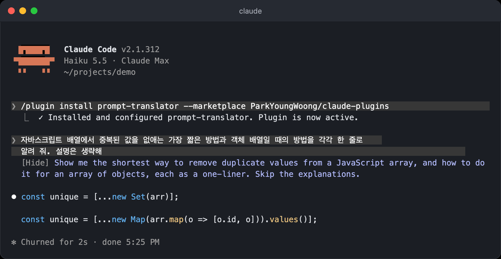

From a shell, pass the language with `--config`.

```bash
claude plugin install prompt-translator --marketplace ParkYoungWoong/claude-plugins --config language=日本語
```

### Claude desktop app

The desktop app doesn't run `/plugin`, so install it from the plugin settings.

1. Click the + button next to the prompt box and choose Add plugins.

   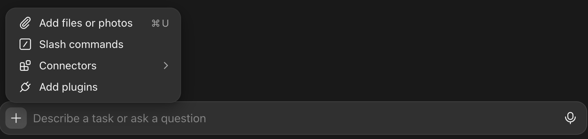

2. Click Add at the top right, choose Add marketplace, enter `ParkYoungWoong/claude-plugins`, and click Sync.

   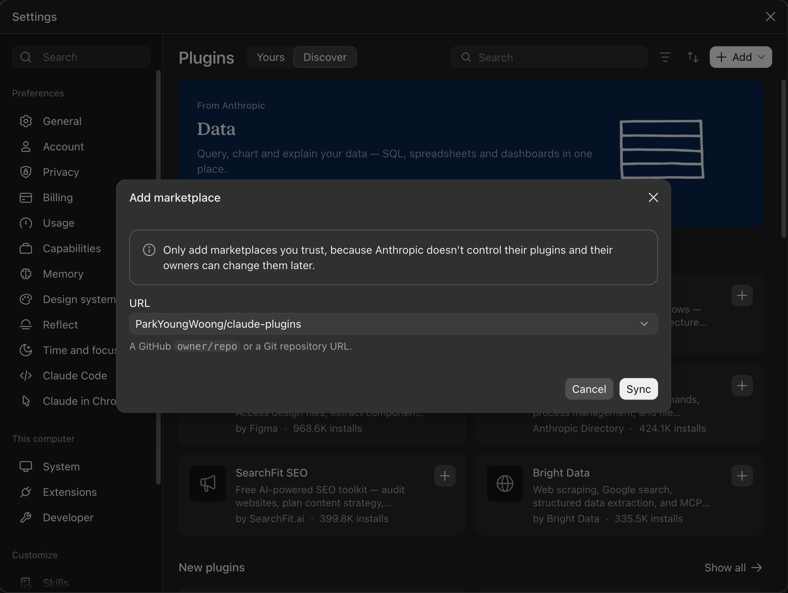

3. In the Discover tab, find Prompt translator and click Add to this computer.  
   Filtering by Source > heropy-plugins shows only the plugins from this marketplace.

   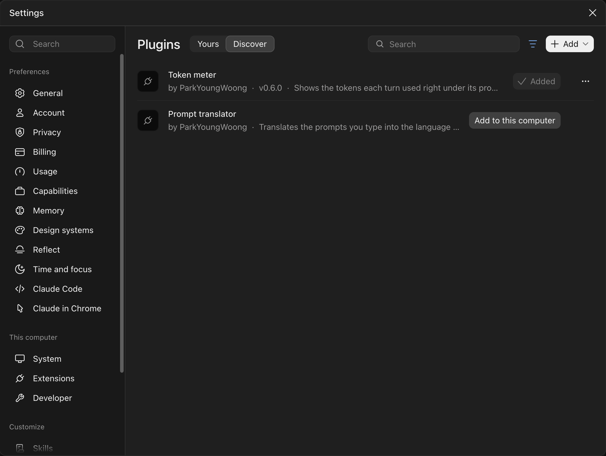

4. The desktop app doesn't ask for the options while installing, so it starts with English (US) and a 300-character limit.  
   The limit is saved as 300 the first time a session starts, so the field shows it from then on.  
   To change them, open Prompt translator in the Yours tab, set Translation language and Auto-translate limit in its Settings tab, and click Save.  
   The new values apply to sessions you start after that.

   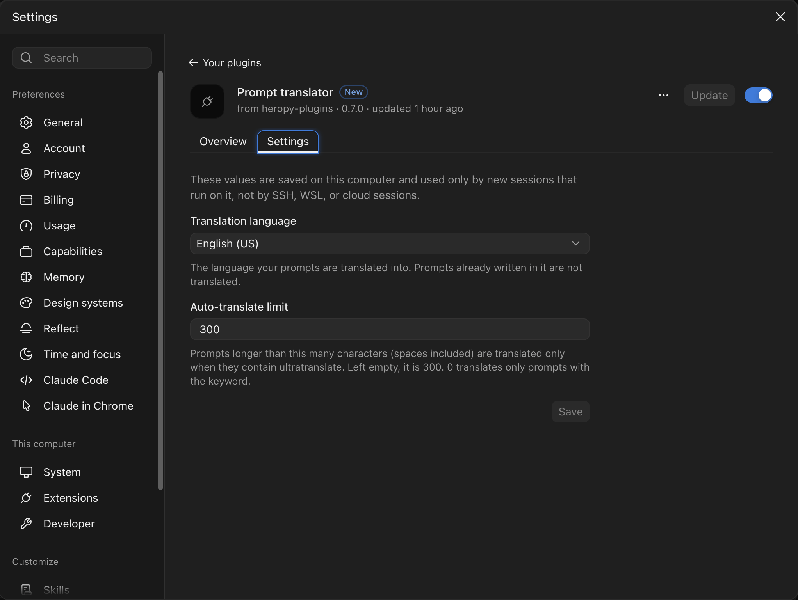

5. In a new session, the translation shows in a bubble right under your prompt, aligned to the right like the prompt itself.  
   The language is at the top, and `Hide` at the top right folds the bubble down to that line.

   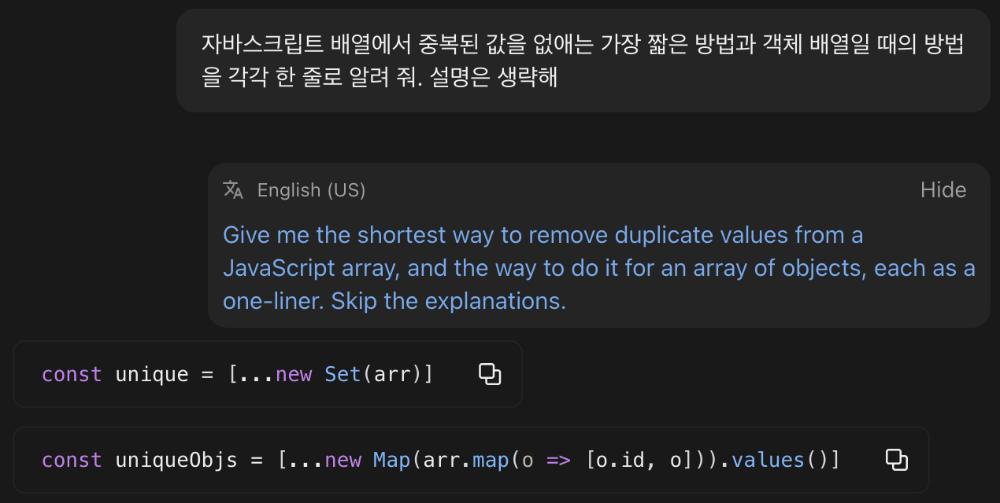

## Translation languages

| Option | Translates into |
| --- | --- |
| `English (US)` (default) | American English |
| `English (UK)` | British English (colour, organise, ...) |
| `한글` | Korean |
| `日本語` | Japanese |
| `中文 (简体)` | Simplified Chinese |
| `Español` | Spanish |

Only prompts written in a language other than the one you chose are translated.  
For example, with `한글` chosen, English prompts are translated into Korean, and Korean prompts are left alone.

To change the language in the terminal, run `/config`, type `translation` to find `Translation language`, and pick a new one.  
The mod reloads right away with the new language.

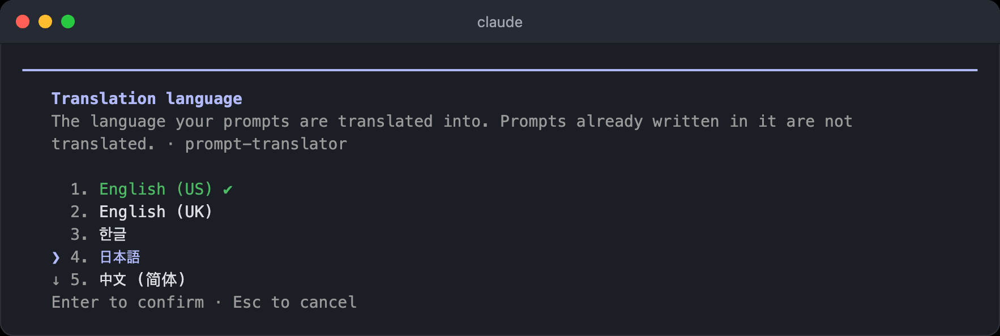

After switching to `日本語`, the same kind of prompt is translated into Japanese.

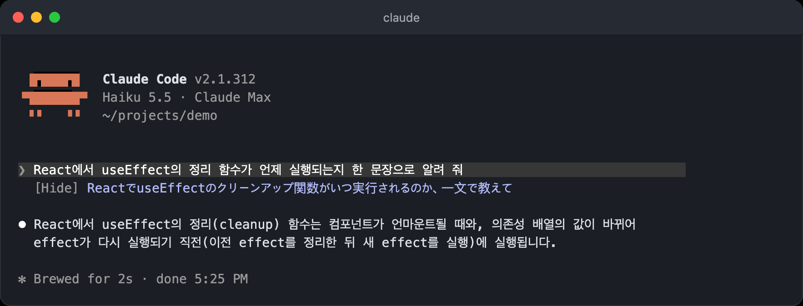

## How it works

- The translation is only for reading.  
  Claude still receives your original prompt.
- Translation and Claude's work start at the same time.  
  `Translating...` shows under the prompt until the translation is ready, and then the same spot turns into the translation.
- The translation is attached to the prompt row, so it scrolls along with the transcript.
- Click `[Hide]` in front of a translation to hide that translation alone, and it turns into `[Show]`.  
  Click `[Show]` to bring the translation back.
- The translation starts right after the button, and a long one wraps under the button instead of leaving an empty column beside it.  
  Line breaks follow your prompt: a blank line shows up only where your prompt has one.
- Code, file paths, commands, identifiers, URLs, @mentions, and anything inside backticks stay as written.  
  Quoted text meant to be used verbatim (an exact reply, a UI label, a commit message) also stays in its original language.
- When a translation fails, only `Could not translate (reason)` is shown.  
  Claude's work goes on as usual.
- For a slash command that puts Claude to work, such as `/goal` or a skill, the text after the command (its arguments) is translated.  
  A command row has no spot a mod can draw under, so the translation shows right above Claude's first reply to that command.
- It also works in Claude Code in the Claude desktop app, where the translation is drawn as a bubble under the prompt with `Hide`/`Show` at its top right.  
  A first prompt sent before the app attaches its view to the session is translated as soon as the view attaches.

## When it doesn't translate

- Prompts already written in the language you chose
- Prompts too short to tell the language from, such as `ok` or `continue`.  
  Korean, Japanese and Chinese are told apart by their characters, and English and Spanish by common words.
- Slash commands that finish without any work from Claude, such as `/rename`
- Messages you didn't type yourself, such as task notifications
- Runs without a screen (`claude -p`)
- Prompts longer than the auto-translate limit (300 characters by default), spaces and pasted text included.  
  Nothing is shown for these.

## Translating long prompts: `ultratranslate`

Put `ultratranslate` anywhere in a prompt (case-insensitive) to translate it even when it runs past the auto-translate limit.  
The keyword is removed before the prompt reaches Claude, so it doesn't change the work.  
It works in a slash command's arguments too (`/goal ... ultratranslate`).

The limit is 300 characters by default.  
Change `Auto-translate limit` in `/config` (or in the plugin's Settings tab in the desktop app), or pass it when installing from a shell.  
Set it to `0` to translate only the prompts that contain `ultratranslate`.

```bash
claude plugin install prompt-translator --marketplace ParkYoungWoong/claude-plugins --config maxChars=500
```

## Cost

Translations are requested from Claude Sonnet 5.5 (`claude-sonnet-5-5`, effort low).  
They count toward the usage of the account signed in to the session.

## Turning it off

Turn off prompt-translator in `/plugin`, or run this in a shell.

```bash
claude plugin disable prompt-translator@heropy-plugins
```

## Development

```bash
claude plugin validate plugins/prompt-translator
claude plugin test plugins/prompt-translator
```
