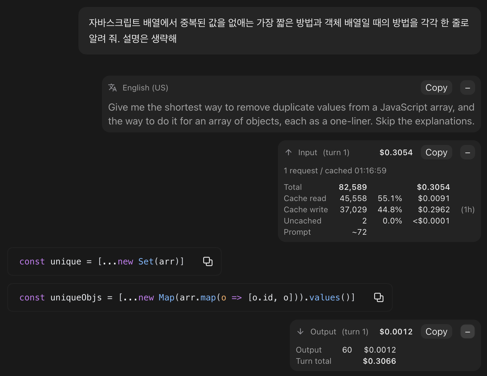

# token-meter

대화 기록에 턴마다 쓴 토큰과 그 비용을 보여 주는 Claude Code Mod입니다.  
턴은 프롬프트 하나와 그에 대한 Claude의 작업 전체를 말합니다.  
각 프롬프트 밑에는 그 턴의 입력이, 턴의 마지막 답변 밑에는 출력이 턴 번호와 함께 보입니다.  
비용은 Anthropic API 정가로 매기고, 캐시 읽기와 캐시 쓰기를 나눠 셉니다.  
터미널에서는 접힌 한 줄로 시작하고, 펼치면 토큰, 비율, 비용 열을 맞춘 표가 나옵니다.  
데스크톱 앱에서는 같은 내용이 카드로 보이고, 카드도 접힌 채로 시작합니다.

[English](./README.md)

```plaintext
> 이 버그를 고쳐 줄래
  [+] INPUT   42,362 tok  $0.0105  (turn 3 / 2 requests / cached 13:56:08)

  고쳤습니다.
  [+] OUTPUT   2,400 tok  $0.0480  (turn 3 / turn total $0.0585)
```

## 설치

```plaintext
/plugin install token-meter --marketplace ParkYoungWoong/claude-plugins
```

`Add marketplace?`에 `y`로 답하고 설치 범위를 고르면 바로 동작합니다.  
Claude Code 2.1.299 이상이 필요합니다.  
다른 설치 방법은 [저장소 README](../../README.ko.md#설치)를 참고하세요.

## 표시 항목

터미널에서는 입력과 출력이 접힌 한 줄로 보입니다.  
줄 앞의 `[+]`를 누르면 표로 펼쳐지고, `[-]`를 누르면 다시 접힙니다.  
줄마다 따로 접고 펼치며, 펼친 줄은 화면을 다시 그려도 펼친 채로 남습니다.

```plaintext
> 이 버그를 고쳐 줄래
  [-] INPUT  (turn 3 / 2 requests / cached 13:56:08)
                       TOK       %      COST
      total         42,362           $0.0105
      cache read    42,100   99.3%   $0.0084
      cache write      247    0.5%   $0.0020   (1h)
      uncached          15    0.0%   $0.0001
      prompt           ~12
      context           15

  고쳤습니다.
  [-] OUTPUT  (turn 3)
                       TOK              COST
      output         2,400           $0.0480
      turn total                     $0.0585
```

머리줄 괄호 안의 맥락:

- `turn N`: 세션에서 몇 번째 턴인지입니다.  
  사람이 시작한 턴(프롬프트, `/goal` 같은 명령)을 1부터 세고, `/clear` 뒤에도 이어서 셉니다.  
  플러그인을 설치하기 전의 턴은 세지 않습니다.
- `N requests`: 이 턴의 요청 횟수입니다.  
  도구를 쓸 때마다 늘어납니다.
- `cached HH:MM:SS`: 이 입력을 실은 첫 요청에 서버가 응답을 시작한 시각(이 컴퓨터의 시간대)입니다.  
  이 시각에는 입력이 프롬프트 캐시에 저장되어 있습니다.
- `turn total $N`(접힌 출력 줄): 입력과 출력을 더한 이 턴의 비용입니다.

입력 표:

- `total`: 이 턴에 서버로 보낸 입력 토큰의 합과 입력 비용입니다.  
  요청마다 시스템 프롬프트와 지난 대화 전체를 다시 보내므로, 요청별 전체 입력(input + cache read + cache write)을 더합니다.  
  아래 세 줄(`cache read`, `cache write`, `uncached`)의 토큰을 더하면 `total`과 같고, 비용도 반올림 차이를 빼면 같습니다.
- `cache read`: 프롬프트 캐시에서 읽은 토큰입니다.
- `cache write`: 프롬프트 캐시에 새로 쓴 토큰입니다.  
  끝의 `(1h)`나 `(5m)`은 캐시 보존 시간이고, 새로 쓴 양이 없으면 줄이 빠집니다.
- `uncached`: 캐시를 거치지 않은 입력입니다.
- `%`: `total`에서 그 줄이 차지하는 비율입니다.  
  소수 첫째 자리까지만 남기고 나머지는 버려서, 그 줄이 전부가 아닌데 100.0%로 보이는 일이 없습니다.
- `prompt ~N`: 입력한 글을 글자 수로 어림한 토큰입니다.  
  한글은 1글자에 약 1.35토큰, 그 밖의 글자는 3.2자에 1토큰으로 셉니다(Opus 5.5 실측).
- `context N`: 이 입력이 컨텍스트에 실제로 더한 토큰입니다.  
  턴의 첫 요청 입력에서 직전 요청의 입력과 출력을 뺀 값이고, 첫 턴과 압축, `/clear` 직후에는 빠집니다.

출력 표:

- `output`: 그 턴의 모든 요청이 낸 출력 토큰의 합(생각과 도구 호출 포함)과 출력 비용입니다.
- `turn total`: 입력과 출력을 더한 이 턴의 비용입니다.

숫자 열은 오른쪽 끝을 맞춰서 쉼표, 소수점, `%`, `$`가 줄마다 같은 칸에 옵니다.  
이름과 열 제목은 옅게, 합계 줄의 숫자는 굵게 보입니다.

## 비용

요청마다 그 요청에 답한 모델의 정가로 따로 매깁니다.  
그래서 턴 중간에 모델이 바뀌어도(폴백, `/model`) 맞게 계산됩니다.  
금액은 소수 넷째 자리까지 보이고, 그보다 작은 금액은 `<$0.0001`로 보입니다.  
금액마다 따로 반올림하므로 표의 항목별 금액을 더하면 `total`이나 `turn total`과 $0.0001쯤 다를 수 있습니다.

| 모델 | 입력 | 캐시 읽기 | 출력 |
| --- | --- | --- | --- |
| Fable 5.2, Mythos 5.2 | $8 | $0.20 | $40 |
| Fable 5.1, Mythos 5.1 | $10 | $0.25 | $50 |
| Fable 5, Mythos 5 | $10 | $1 | $50 |
| Opus 5.5 | $4 | $0.20 | $20 |
| Opus 5, Opus 4.8, 4.7, 4.6 | $5 | $0.50 | $25 |
| Sonnet 5.5 | $2 | $0.10 | $10 |
| Sonnet 5 | $2 | $0.20 | $10 |
| Sonnet 4.6 | $3 | $0.30 | $15 |
| Haiku 5.5 (요청의 전체 입력 10만 토큰 이하) | $0.10 | $0.01 | $0.50 |
| Haiku 5.5 (요청의 전체 입력 10만 토큰 초과) | $0.50 | $0.05 | $2.50 |
| Haiku 4.5 | $1 | $0.10 | $5 |

100만 토큰당 가격이며, 2026-11-03 기준 Anthropic API 정가입니다.  
Haiku 5.5는 요청마다 그 요청의 전체 입력으로 정가를 고릅니다.

캐시 쓰기는 캐시에 5분 동안 두면 입력 단가의 1.25배, 1시간 동안 두면 2배입니다.  
어느 쪽인지는 `cacheTtl` 설정(`auto`, `5m`, `1h`)으로 고르고, 기본값은 `auto`입니다.  
`auto`는 Claude Code와 같은 순서로 정합니다.  
`/plugin`으로 설치할 때 묻고, 나중에는 `/config`나 데스크톱 앱의 플러그인 `설정` 탭에서 바꿀 수 있습니다.

1. `FORCE_PROMPT_CACHING_5M`이 있으면 5분
2. `CLAUDE_CODE_PROMPT_CACHE_TTL`이나 `promptCacheTtl` 설정이 있으면 그 값
3. `ENABLE_PROMPT_CACHING_1H`가 있으면 1시간
4. 그 밖에는 Claude 구독으로 로그인했으면 1시간, API 키면 5분(구독 여부는 세션이 받는 사용량 한도 정보로 가립니다)

알아 둘 점:

- 정가로 어림한 값입니다.  
  Claude 구독은 토큰 단위로 청구되지 않고, Bedrock, Vertex AI 같은 공급자는 가격이 따로 있습니다.
- 빠른 모드(fast mode)는 더 비싸지만(Opus 5.5는 2배) 요청 결과에 빠른 모드 여부가 없어 기본 정가로 매깁니다.
- 구독에서 추가 사용량(extra usage)으로 넘어가면 Claude Code는 캐시를 5분 동안 두는데, `auto`는 그래도 1시간으로 매깁니다.  
  이 차이가 중요하면 `cacheTtl`을 `5m`으로 바꾸세요.
- 서브에이전트의 요청과 Claude Code가 뒤에서 보내는 작은 요청은 세지 않으므로, 합계가 `/cost`보다 작을 수 있습니다.
- 정가표에 없는 모델을 쓴 턴은 금액 자리에 `$?`가 보이고, 펼친 표에는 금액 열 없이 그 모델 이름이 적힙니다.

## 숫자가 채워지는 때

응답이 오기 전에는 어림한 프롬프트 토큰과 턴 번호만 보이고, 펼칠 표가 없어 단추도 없습니다.

```plaintext
      INPUT      ~12 tok           (turn 3 / waiting for response)
```

응답이 오면 나머지가 채워지고 단추가 생깁니다.  
데스크톱 카드도 응답 전에는 턴 번호와 프롬프트 토큰만 있고 단추가 없습니다.  
작업 알림처럼 사람이 입력하지 않은 줄에는 표시하지 않습니다.

## 슬래시 명령과 작업 중에 보낸 프롬프트

- `/goal`이나 스킬처럼 턴을 시작하는 명령은 명령 줄에 Mod가 그릴 자리가 없습니다.  
  그래서 입력 토큰은 그 턴의 첫 답변 바로 위에 보입니다.  
  `prompt ~N`은 입력한 명령 줄을 어림한 값이고, `context N`에는 명령이 덧붙인 지시문도 들어갑니다.
- `/rename`처럼 턴을 시작하지 않는 명령에는 아무것도 표시하지 않습니다.
- Claude가 작업하는 중에 보낸 프롬프트는 진행 중인 턴에 합쳐지므로 어림한 토큰(`~N tok`)만 보입니다.  
  그 입력의 토큰은 진행 중이던 턴의 숫자에 들어갑니다.

## 클로드 데스크톱 앱

클로드 데스크톱 앱의 Claude Code에서는 같은 자리에 줄 대신 카드로 보입니다.  
카드는 입력 말풍선처럼 오른쪽 끝에 붙고, 모양은 prompt-translator의 번역 카드와 같습니다.

카드에는 터미널의 표와 같은 내용이 모두 들어갑니다.

- 입력 카드: 머리줄에 `Input`과 턴 번호(`(turn 3)`), 입력 비용이 있습니다.  
  그 밑에 요청 횟수와 캐시에 쓴 시각이 한 줄로 있고, 표에 total, 캐시 읽기, 캐시 쓰기(보존 시간 포함), 캐시 안 거친 입력, 프롬프트, 컨텍스트가 토큰, 비율, 비용 열로 있습니다.
- 출력 카드: 머리줄에 `Output`과 턴 번호, 출력 비용이 있고, 그 밑에 출력 토큰과 턴 합계가 있습니다.



위 화면은 두 카드를 펼친 모습입니다. prompt-translator와 함께 써서 입력 카드 위에 번역 카드가 있습니다.

카드는 접힌 채로 시작해 머리줄 한 줄만 보입니다.  
머리줄에는 제목, 턴 번호, 전체 토큰 수, 금액이 있어 터미널의 접힌 줄과 같은 정보입니다(예: `Input (turn 3)  42,362 tok  $0.0105`).  
오른쪽 끝에는 옅은 회색 칸에 담긴 `Copy` 단추와 접기 단추가 있습니다.

- 더하기 단추를 누르면 그 카드가 펼쳐져 맥락 한 줄과 표가 보이고, 단추는 빼기로 바뀝니다.  
  빼기 단추를 누르면 다시 접힙니다.
- 카드마다 따로 접힙니다.  
  같은 턴의 입력 카드와 출력 카드도 따로 접고 펼칩니다.
- 한 화면에서 접거나 펼쳐도 다른 화면(터미널과 데스크톱 앱)에는 영향이 없습니다.
- `Copy`를 누르면 그 카드 내용을 터미널의 펼친 표와 같은 모양의 글로 클립보드에 복사합니다.  
  단추는 잠시 `Copied`(실패하면 `Copy failed`)로 바뀌었다가 돌아옵니다.  
  데스크톱 앱은 대화 기록에서 Mod가 그린 글을 드래그로 고를 수 없어서 이 단추로 복사합니다.

```plaintext
INPUT  (turn 3 / 2 requests / cached 13:56:08)
                 TOK       %      COST
total         42,362           $0.0105
cache read    42,100   99.3%   $0.0084
cache write      247    0.5%   $0.0020   (1h)
uncached          15    0.0%   $0.0001
prompt           ~12
context           15
```

## 끄기

터미널에서는 `/plugin`에서 token-meter를 끄거나, 셸에서 다음 명령을 실행합니다.

```bash
claude plugin disable token-meter@heropy-plugins
```

데스크톱 앱에서는 입력창 옆 + 단추에서 `플러그인 > 플러그인 관리`를 열고, `내 항목` 탭의 Token meter 오른쪽 추가 작업 메뉴에서 `끄기`를 누릅니다.  
같은 메뉴의 `제거`는 플러그인을 지웁니다.

## 개발

```bash
claude plugin validate plugins/token-meter
claude plugin test plugins/token-meter
```
