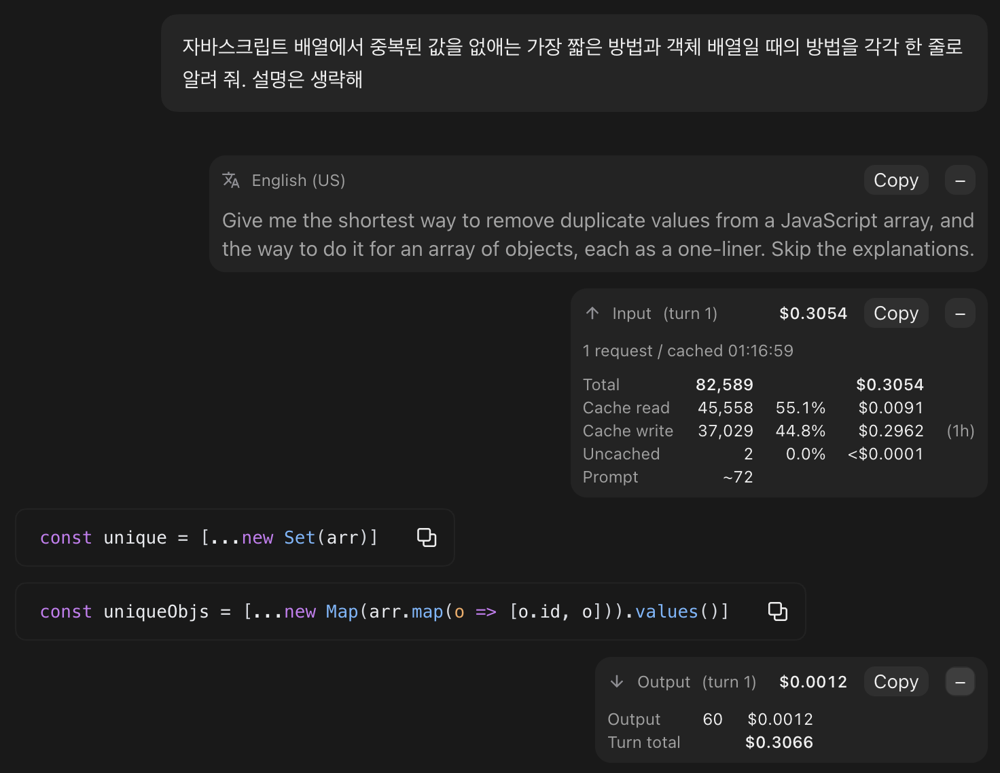

# token-meter

A Claude Code mod that shows the tokens each turn used, and what they cost, in the transcript.  
A turn is one prompt and all the work Claude does for it.  
Each turn's input appears under its prompt and its output under the turn's last reply, with the turn number.  
Costs are priced at the Anthropic API list price, with cache reads and cache writes counted apart.  
In the terminal each starts as one folded line, which unfolds into a table with token, share and cost columns lined up.  
In the desktop app the same numbers show as cards, which also start folded.

Read this in [한글](./README.ko.md).

```plaintext
> 이 버그를 고쳐 줄래
  [+] INPUT   42,362 tok  $0.0105  (turn 3 / 2 requests / cached 13:56:08)

  고쳤습니다.
  [+] OUTPUT   2,400 tok  $0.0480  (turn 3 / turn total $0.0585)
```

## Install

```plaintext
/plugin install token-meter --marketplace ParkYoungWoong/claude-plugins
```

Answer `y` to `Add marketplace?` and pick a scope, and the plugin starts working right away.  
It needs Claude Code 2.1.299 or later.  
For other ways to install, see the [repository README](../../README.md#install).

## What it shows

In the terminal, the input and the output each show as one folded line.  
Press `[+]` in front of a line to unfold it into a table, and `[-]` to fold it again.  
Each line folds on its own, and an unfolded line stays unfolded when the screen is drawn again.

```plaintext
> 이 버그를 고쳐 줄래
  [-] INPUT  (turn 3 / 2 requests / cached 13:56:08)
                       TOK       %      COST
      total         42,362           $0.0105
      cache read    42,100   99.3%   $0.0084
      cache write      247    0.5%   $0.0020   (1h)
      uncached          15    0.0%   $0.0001
      prompt           ~12
      context           15

  고쳤습니다.
  [-] OUTPUT  (turn 3)
                       TOK              COST
      output         2,400           $0.0480
      turn total                     $0.0585
```

The context in parentheses on the top line:

- `turn N`: which turn of the session this is.  
  Turns a person starts (a prompt, or a command such as `/goal`) are counted from 1, and the count goes on after `/clear`.  
  Turns from before the plugin was installed are not counted.
- `N requests`: how many requests the turn made.  
  It goes up each time Claude uses a tool.
- `cached HH:MM:SS`: when the server started answering the first request that carried this prompt, in this computer's time zone.  
  By then the input is stored in the prompt cache.
- `turn total $N` (on the folded output line): what the turn costs, input and output together.

The input table:

- `total`: the input tokens sent to the server during the turn, and what they cost.  
  Every request resends the system prompt and the whole conversation so far, so this adds up each request's full input (input + cache read + cache write).  
  The tokens of the three rows below it (`cache read`, `cache write`, `uncached`) add up to `total`, and so do their costs, give or take rounding.
- `cache read`: tokens read from the prompt cache.
- `cache write`: tokens newly written to the prompt cache.  
  The `(1h)` or `(5m)` at the end is how long the cache keeps them, and the row is left out when nothing was written.
- `uncached`: input that did not go through the cache.
- `%`: the row's share of `total`.  
  It keeps one decimal place and drops the rest, so it never shows 100.0% unless everything came from that row.
- `prompt ~N`: tokens estimated from the length of what you typed.  
  Hangul counts as about 1.35 tokens per character, and other characters as 1 token per 3.2 characters (measured on Opus 5.5).
- `context N`: the tokens this prompt actually added to the context.  
  It is the input of the turn's first request minus the input and output of the request before it, and it is left out on the first turn and right after compaction or `/clear`.

The output table:

- `output`: the output tokens of every request in the turn, thinking and tool calls included, and what they cost.
- `turn total`: what the turn costs, input and output together.

The number columns are right-aligned, so commas, decimal points, `%` and `$` line up from row to row.  
Names and column headings are dimmed, and the numbers on a total row are bold.

## Cost

Each request is priced on its own, at the list price of the model that answered it.  
So a turn whose model changes partway (a fallback, `/model`) is still priced right.  
Amounts are shown to four decimal places, and an amount too small for that shows as `<$0.0001`.  
Each amount is rounded on its own, so the costs of the rows in a table can add up to $0.0001 off from `total` or `turn total`.

| Model | Input | Cache read | Output |
| --- | --- | --- | --- |
| Fable 5.2, Mythos 5.2 | $8 | $0.20 | $40 |
| Fable 5.1, Mythos 5.1 | $10 | $0.25 | $50 |
| Fable 5, Mythos 5 | $10 | $1 | $50 |
| Opus 5.5 | $4 | $0.20 | $20 |
| Opus 5, Opus 4.8, 4.7, 4.6 | $5 | $0.50 | $25 |
| Sonnet 5.5 | $2 | $0.10 | $10 |
| Sonnet 5 | $2 | $0.20 | $10 |
| Sonnet 4.6 | $3 | $0.30 | $15 |
| Haiku 5.5 (request input up to 100K) | $0.10 | $0.01 | $0.50 |
| Haiku 5.5 (request input over 100K) | $0.50 | $0.05 | $2.50 |
| Haiku 4.5 | $1 | $0.10 | $5 |

Prices are per million tokens, the Anthropic API list prices as of 2026-11-03.  
Haiku 5.5 picks its rate for each request by that request's whole input.

A cache write costs 1.25x the input price when the cache keeps it for 5 minutes, and 2x for 1 hour.  
The `cacheTtl` setting chooses which (`auto`, `5m`, `1h`), and it defaults to `auto`.  
`auto` decides in the same order Claude Code does.  
Installing with `/plugin` asks for it, and you can change it later in `/config` or, in the desktop app, in the plugin's settings tab.

1. `FORCE_PROMPT_CACHING_5M` set: 5 minutes.
2. `CLAUDE_CODE_PROMPT_CACHE_TTL` or the `promptCacheTtl` setting: that value.
3. `ENABLE_PROMPT_CACHING_1H` set: 1 hour.
4. Otherwise 1 hour when signed in with a Claude subscription, and 5 minutes on an API key (a subscription is told apart by the usage limit details the session receives).

Things to know:

- It is an estimate at list price.  
  A Claude subscription is not billed per token, and Bedrock, Vertex AI and other providers have their own prices.
- Fast mode costs more (2x on Opus 5.5), but a request does not say it ran in fast mode, so it is priced at the standard rate.
- On a subscription that has gone into extra usage, Claude Code writes the cache for 5 minutes, but `auto` still prices it at 1 hour.  
  Set `cacheTtl` to `5m` if that matters.
- Subagent requests and Claude Code's own small background requests are not counted, so the total can be lower than `/cost`.
- A turn that used a model missing from the price table shows `$?` in place of the cost, and its unfolded table names that model with no cost column.

## When the numbers fill in

Before the first response arrives, only the estimated prompt tokens and the turn number show, with no button since there is no table to unfold yet.

```plaintext
      INPUT      ~12 tok           (turn 3 / waiting for response)
```

The rest fills in and the button appears once the response comes in.  
A desktop card likewise holds only the turn number and the prompt tokens, with no button, until then.  
Rows a person didn't type, such as task notifications, are left alone.

## Slash commands and prompts sent mid-turn

- A command that starts a turn, such as `/goal` or a skill, has no row a mod can draw under.  
  So its input tokens show right above the first reply of that turn.  
  `prompt ~N` is estimated from the command line you typed, and `context N` includes the instructions the command adds.
- Commands that don't start a turn, such as `/rename`, show nothing.
- A prompt you send while Claude is working joins the running turn, so it shows only its estimated tokens (`~N tok`).  
  Its tokens are counted in the numbers of the turn that was running.

## Claude desktop app

In Claude Code in the Claude desktop app, the numbers show in the same places as cards instead of lines.  
Each card sits at the right edge, like your prompts, and looks like prompt-translator's translation card.

A card holds everything the terminal table does.

- Input card: `Input`, the turn number (`(turn 3)`) and the input cost on top.  
  Under it, one line gives the requests and the time it was cached, and a table lists total, cache read, cache write (with how long the cache keeps it), uncached, prompt and context in token, share and cost columns.
- Output card: `Output`, the turn number and the output cost on top, then the output tokens and the turn total.



The screenshot shows both cards unfolded, with prompt-translator installed too, so a translation card sits above the input card.

A card starts folded, showing only its top line.  
The top line holds the title, the turn number, the total tokens and the cost, the same as a folded terminal line (for example `Input (turn 3)  42,362 tok  $0.0105`).  
At its right end are a `Copy` button and a fold button, each in a faint gray box.

- Press the plus button to unfold the card, showing a line of context and the table, and the button turns into a minus.  
  Press the minus button to fold it again.
- Each card folds on its own.  
  The input card and the output card of the same turn fold apart too.
- Folding or unfolding on one screen (the terminal or the desktop app) doesn't touch the other.
- Press `Copy` to copy the card to the clipboard as text laid out like the unfolded terminal table.  
  The button reads `Copied` (or `Copy failed`) for a moment and then turns back.  
  The desktop app doesn't let you drag-select text a mod draws in the transcript, so this button is how to copy it.

```plaintext
INPUT  (turn 3 / 2 requests / cached 13:56:08)
                 TOK       %      COST
total         42,362           $0.0105
cache read    42,100   99.3%   $0.0084
cache write      247    0.5%   $0.0020   (1h)
uncached          15    0.0%   $0.0001
prompt           ~12
context           15
```

## Turning it off

In the terminal, turn off token-meter in `/plugin`, or run this in a shell.

```bash
claude plugin disable token-meter@heropy-plugins
```

In the desktop app, click the + button next to the prompt box, open Plugins and then the item that manages them, and in the Yours tab open the menu to the right of Token meter and turn it off.  
The same menu also removes the plugin.

## Development

```bash
claude plugin validate plugins/token-meter
claude plugin test plugins/token-meter
```
